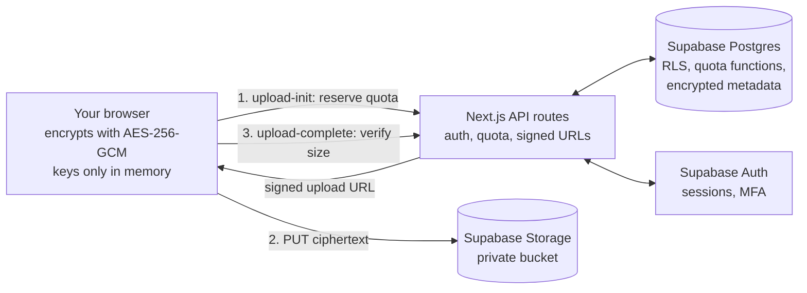

<div align="center">


# VaultSpace

### Your private digital universe — cloud storage where **only you** hold the keys

Files and file names are encrypted **in your browser** with AES-256-GCM before they ever leave your device.
Share securely, keep version history, and stay inside a free-tier budget.

[](https://vault-space.vercel.app/)
[](https://github.com/Roni-Seikh/VaultSpace)


**[🌐 Live demo](https://vault-space.vercel.app/)** · **[📦 Repository](https://github.com/Roni-Seikh/VaultSpace)** · **[📚 Docs](docs/)** · **[🐞 Report an issue](https://github.com/Roni-Seikh/VaultSpace/issues)**

</div>

---

## 📑 Table of contents
1. [What is VaultSpace?](#-what-is-vaultspace)
2. [The problem it solves](#-the-problem-it-solves)
3. [Features](#-features)
4. [How it works](#-how-it-works)
5. [Security model (honest version)](#-security-model-honest-version)
6. [Tech stack](#-tech-stack)
7. [Project structure](#-project-structure)
8. [Getting started (Windows PowerShell)](#-getting-started-windows-powershell)
9. [Environment variables](#-environment-variables)
10. [Database setup](#-database-setup)
11. [Using the app](#-using-the-app)
12. [Storage limits and cost (free tier)](#-storage-limits-and-cost-free-tier)
13. [Deploying to Vercel](#-deploying-to-vercel)
14. [Testing and verification status](#-testing-and-verification-status)
15. [API overview](#-api-overview)
16. [Troubleshooting](#-troubleshooting)
17. [Roadmap](#-roadmap)
18. [Developer](#-developer)
19. [Contributing and license](#-contributing-and-license)

---

## 🔐 What is VaultSpace?

VaultSpace is a full-stack, privacy-first cloud storage web application. You sign up, create a **vault passphrase**, and from then on every file you upload — and even its name — is encrypted by your browser. The server, the database and the storage bucket only ever see scrambled ciphertext.

It looks and feels like a modern drive (folders, gallery, document viewer, sharing, version history, storage dashboard) but the encryption keys live only in your browser's memory while your vault is unlocked.

## 🎯 The problem it solves

Mainstream cloud storage providers can read your files. A data breach, an insider, or a leaked backup exposes everything. VaultSpace shows how to build storage where a leak of the database **or** the storage bucket does not reveal file contents or names — while staying fully usable on free infrastructure.

## ✨ Features

| Area | What you get |
|---|---|
| 🛡️ **Client-side encryption** | AES-256-GCM, chunked (4 MiB) with tamper-proof ordering; random key per file; encrypted file *and* folder names |
| 🔑 **Vault & recovery** | Passphrase → Argon2id key derivation; one-time recovery key; change passphrase; auto-lock after 15 min idle |
| 👤 **Accounts** | Email sign-up / sign-in, password reset, optional TOTP two-factor authentication, session list |
| 👁️ **Password visibility** | Every password box has a show/hide eye button |
| 📁 **File manager** | Upload (drag & drop, progress, multiple files), folders, rename, move, copy, delete, search, sort |
| 🖼️ **Gallery** | Image/video grid with decrypted-on-device previews |
| 📄 **Documents** | In-browser viewer for PDFs (rendered to canvas, no scripts) and text files |
| 🕘 **Versions** | Upload a new version of a file, browse history, restore or delete old versions |
| 🔗 **Secure sharing** | Share links with expiry, optional password, download on/off, instant revoke; decryption key stays in the URL `#fragment` and never reaches the server |
| 🤖 **Local AI assistant** | Ask things like "show PDFs from last week"; runs 100 % in your browser — **no external AI, no paid API** |
| 📊 **Storage dashboard** | Usage vs. your quota and the global cap, category breakdown, duplicate finder, recent activity |
| 🧰 **Security center** | MFA setup, sessions, activity/audit log (no secrets stored), passphrase & recovery-key management |
| 🧑‍💼 **Admin panel** | Aggregate usage and user list — never file contents or names |
| 🎨 **Premium UI** | Navy / white / indigo-violet theme, light & dark modes, fully responsive, accessible |
| 💸 **Free-tier friendly** | Per-user quota plus a global cap enforced **on the server** so you cannot accidentally exceed free limits |

## ⚙️ How it works



**Upload flow:** the browser checks the file's real type by its magic bytes → encrypts it in 4 MiB chunks → asks the server to *reserve* quota → uploads ciphertext straight to storage → the server verifies the stored size and *commits*. A failed upload releases the reservation automatically.

**Key hierarchy:**

```
Vault passphrase ──Argon2id (64 MiB, 3 passes)──▶ key-encryption key
                                                      │ wraps
                                                      ▼
                                            256-bit master key  ◀── also wrapped by your Recovery Key
                                                      │ derives
                          ┌───────────────────────────┼───────────────────────────┐
                          ▼                           ▼                           ▼
                  file-key wrapping           name encryption             duplicate-detection HMAC
                          │
                          ▼
              random AES-256 key per file ──▶ encrypts that file's chunks
```

**Sharing:** a link looks like `/s/<token>#<secret>`. The server stores only a hash of `<token>`; the `<secret>` after `#` is never sent to the server, so the server cannot decrypt shared files. Expired, revoked and non-existent links all look identical (404).

## 🧪 Security model (honest version)

- **Client-side encrypted — but not "zero-knowledge".** The server still knows your email, file sizes, categories and timestamps. It also serves the JavaScript that does the encryption, so a compromised server could ship malicious code. Client-side encryption protects against **storage/database leaks**, not against a fully compromised app server.
- **Lost passphrase *and* recovery key = lost data.** Nobody, including the operator, can recover it.
- Row Level Security on every table; users cannot change their own role or quota.
- Quota logic runs in Postgres functions that only the server can call (race-safe, tested).
- Executable and active content (`.exe`, `.js`, `.html`, `.svg`, …) is refused; previews are allow-listed; PDFs render to canvas.
- Strict CSP and security headers in production; no secrets in logs.
- Known limits: in-memory rate limiting is best-effort; view-only share links are a UI restriction (a recipient holding the link could still save the file).

Full details: [`docs/security-model.md`](docs/security-model.md).

## 🧱 Tech stack

| Layer | Technology |
|---|---|
| Framework | Next.js 16 (App Router, Turbopack), React 19, TypeScript (strict) |
| Styling & motion | Tailwind CSS v4, Framer Motion, Lucide icons, next-themes |
| Backend | Next.js route handlers (no separate server) |
| Database & auth | Supabase Postgres, Row Level Security, Supabase Auth (+TOTP MFA) |
| File storage | Supabase Storage (private bucket, signed URLs) |
| Cryptography | Web Crypto API (AES-GCM, HKDF, HMAC), Argon2id via `hash-wasm` |
| Documents | `pdfjs-dist` (canvas rendering) |
| Local search/AI | MiniSearch + rule-based query parser + extractive summariser |
| Validation | Zod |
| Testing | Vitest, React Testing Library, PGlite (in-memory Postgres), Playwright |
| Hosting | Vercel (Hobby) + GitHub Actions (CI, secret scan, keep-alive) |

## 🗂️ Project structure

```
VaultSpace/
├── src/
│   ├── app/
│   │   ├── (auth)/            login, register, forgot/reset password
│   │   ├── (app)/             dashboard, files, gallery, documents, shared,
│   │   │                      assistant, security, settings, admin
│   │   ├── s/[token]/         public share viewer
│   │   ├── api/               route handlers (vault, files, folders, shares, storage, admin, cron…)
│   │   ├── icon.svg           browser-tab logo
│   │   └── page.tsx           landing page
│   ├── components/            ui/, layout/, vault/, files/, marketing/, auth/
│   ├── lib/
│   │   ├── crypto/            AES-GCM chunk cipher, key hierarchy, share keys
│   │   ├── files/             type detection (magic bytes), names, browsing helpers
│   │   ├── api/               auth guard, errors, rate limit, audit log
│   │   ├── r2/                storage client (Supabase Storage; folder name is historical)
│   │   ├── supabase/          browser / server / admin clients
│   │   ├── assistant/         local query parser, search, summariser
│   │   └── client/            browser-side API + upload/download helpers
│   └── proxy.ts               session refresh and route protection
├── supabase/migrations/       0001 schema · 0002 functions · 0003 RLS
├── tests/                     unit/, db/ (PGlite), e2e/ (Playwright)
├── docs/                      architecture, security, API, deployment, cost, GitHub, interview pack
├── scripts/scan-secrets.mjs   credential scanner
└── .github/workflows/         ci.yml · secret-scan.yml · keepalive.yml
```

## 🚀 Getting started (Windows PowerShell)

**Prerequisites:** [Node.js 20+](https://nodejs.org), [Git](https://git-scm.com), and free accounts on [Supabase](https://supabase.com), [GitHub](https://github.com) and [Vercel](https://vercel.com). No credit card is needed.

```powershell
# 1. Get the code
git clone https://github.com/Roni-Seikh/VaultSpace.git
cd VaultSpace

# 2. Install dependencies
npm install

# 3. Create your environment file, then fill it in (see the table below)
Copy-Item .env.example .env.local
code .env.local

# 4. Run the development server
npm run dev
```

Open **http://localhost:3000**. Before signing up, finish the [database setup](#-database-setup).

Useful scripts:

| Command | Purpose |
|---|---|
| `npm run dev` | Development server |
| `npm run build` / `npm start` | Production build / run |
| `npm run typecheck` | TypeScript check |
| `npm run lint` | ESLint |
| `npm test` | Unit, crypto and database tests |
| `npm run test:e2e` | Playwright browser tests (`npx playwright install chromium` first) |
| `npm run scan:secrets` | Scan the repo for leaked credentials |

## 🔧 Environment variables

Put these in `.env.local` (never commit it) and, for deployment, in Vercel → Settings → Environment Variables.

| Variable | Where to get it | Secret? |
|---|---|---|
| `NEXT_PUBLIC_SUPABASE_URL` | Supabase → Settings → API | No |
| `NEXT_PUBLIC_SUPABASE_ANON_KEY` | Supabase → Settings → API (anon / publishable) | No |
| `SUPABASE_SERVICE_ROLE_KEY` | Supabase → Settings → API (service role) | **Yes – server only** |
| `CRON_SECRET` | Random 32-byte value (see below) | **Yes** |
| `IP_HASH_SALT` | Random 32-byte value | **Yes** |
| `STORAGE_BUCKET` | *(optional)* bucket name, default `vaultspace-files` | No |

Generate random values in PowerShell:
```powershell
[Convert]::ToBase64String([System.Security.Cryptography.RandomNumberGenerator]::GetBytes(32))
```

## 🗄️ Database setup

1. Create a project at [supabase.com/dashboard](https://supabase.com/dashboard).
2. Open **SQL Editor** and run, in order: `supabase/migrations/0001_schema.sql`, `0002_functions.sql`, `0003_rls.sql`.
3. **Authentication → Providers → Email:** enable it; set the minimum password length to 10.
4. **Authentication → URL Configuration:** set the Site URL and add `…/auth/callback` redirect URLs for `http://localhost:3000` and your live domain.
5. Make yourself an admin (optional), after registering:
   ```sql
   update profiles set role = 'admin'
   where id = (select id from auth.users where email = 'you@example.com');
   ```
6. File storage needs no setup: the private bucket `vaultspace-files` is created automatically on the first upload.

## 🧭 Using the app

1. **Register** and confirm your email, then **sign in**.
2. **Create your vault passphrase** (12+ characters). Download or copy the **recovery key** and store it somewhere safe — it is shown once.
3. **Upload** files from *My Files*. Browse by folder, gallery or documents; click a file to preview it (decrypted locally).
4. **Share:** open a file → *Share* → choose expiry, optional password, download permission → copy the link. Revoke any time from *Shared links*.
5. **Versions:** open a file's *Versions* panel → *Upload new version*; restore or delete older versions from the same panel.
6. **Security:** enable two-factor authentication, review sessions and the activity log.
7. After 15 idle minutes (or a page reload) the vault locks; enter your passphrase to unlock.

## 💸 Storage limits and cost (free tier)

Everything runs on free plans with no card: Vercel Hobby, Supabase Free, GitHub. At the time of writing the Supabase Free plan includes **1 GB of file storage and a 50 MB maximum upload**, and pauses projects after **1 week of inactivity** (the included `keepalive.yml` workflow pings `/api/health` to help). Always check the [official pricing page](https://supabase.com/pricing) — limits change.

Defaults in this project: global cap **900 MiB**, per-file cap **45 MiB**, per-user quota configurable in the database. Details and SQL to change them: [`docs/cost-guide.md`](docs/cost-guide.md).

## ☁️ Deploying to Vercel

1. Push the repo to GitHub (never commit `.env.local`; run `npm run scan:secrets` first).
2. In Vercel: **Add New → Project → Import** the repo; keep the Next.js defaults.
3. Add the environment variables from the table above, then **Deploy**.
4. In Supabase → Authentication → URL Configuration, set the Site URL to your Vercel URL and add `https://<your-domain>/auth/callback`.
5. Add the repository variable `APP_URL` (GitHub → Settings → Variables) so the keep-alive workflow can ping your site.
6. Test the live site: `/api/health`, register, create a vault, upload, download, share, revoke.

Full walkthrough: [`docs/deployment.md`](docs/deployment.md). **Live site:** https://vault-space.vercel.app/

## ✅ Testing and verification status

| Check | Result |
|---|---|
| TypeScript (strict), ESLint | Clean |
| Unit, crypto, assistant and database tests (Vitest, in-memory Postgres) | 148 passing |
| Browser tests (Playwright, desktop and mobile Chromium) | 22 passing — landing page, redirects, forms, password toggle, favicon, headers, styling, mobile layout |
| Production build | Passing |
| Secret scan | Clean |

What the automated tests do **not** cover: real Supabase Auth/MFA and email delivery, real uploads and downloads against Supabase Storage, and long-session browser behaviour. Test those manually on your own deployment (checklist in [`docs/deployment.md`](docs/deployment.md), phase M).

## 🔌 API overview

All routes live under `/api` and require a signed-in session unless noted. Mutating requests must come from the same origin. Request bodies are validated with Zod.

| Group | Endpoints |
|---|---|
| Health (public) | `GET /api/health` |
| Vault | `GET/POST/PUT /api/vault` |
| Library | `GET /api/library` |
| Files | `POST /api/files/upload-init` · `upload-complete` · `upload-abort` · `PATCH/DELETE /api/files/:id` · `GET …/download` · `…/key` · `POST …/copy` · versions (`GET`, `DELETE`, `POST …/restore`) |
| Folders | `POST /api/folders` · `PATCH/DELETE /api/folders/:id` |
| Sharing | `GET/POST /api/shares` · `DELETE /api/shares/:id` · public `GET /api/public/shares/:token` and `POST …/access` |
| Account | `GET/PATCH /api/settings` · `GET /api/security` · `POST /api/security/event` · `GET /api/storage` · `GET /api/activity` · `DELETE /api/account` |
| Admin | `GET /api/admin/overview` · `users` · `events` |
| Maintenance | `GET/POST /api/cron/maintenance` (bearer `CRON_SECRET`) |

Full reference with request/response notes: [`docs/api.md`](docs/api.md).

## 🩺 Troubleshooting

| Symptom | Fix |
|---|---|
| Page shows plain unstyled HTML | Make sure `postcss.config.mjs` exists, run `npm install`, delete `.next`, restart `npm run dev` |
| "Missing or invalid server environment variables" | Fill every required value in `.env.local`, then restart the dev server |
| "Something went wrong" on the dashboard | Check the terminal for the real error (usually missing env values or migrations not run) |
| Sign-up email links open the wrong site | Set the Site URL and redirect URLs in Supabase → Authentication → URL Configuration |
| Upload fails with "too large" | Free plan limit: files must be under 45 MiB |
| Vercel build fails at type-check | Run `npm run typecheck` locally and fix the reported file |
| First load after a week is slow or fails | The free Supabase project was paused — resume it in the dashboard |
| Forgot vault passphrase | Use the recovery key. Without both, data cannot be recovered |

## 🗺️ Roadmap

- Redis-backed rate limiting for multi-instance deployments
- Resumable and parallel chunk uploads for larger files
- Shared folders and team vaults
- Passkey (WebAuthn) sign-in
- Key rotation and re-encryption tooling
- Offline-first sync

## 👨‍💻 Developer

**Roni Seikh** — B.Tech Computer Science & Engineering student (batch of 2027), Brainware University.

| | |
|---|---|
| GitHub | [@Roni-Seikh](https://github.com/Roni-Seikh) |
| This project | [github.com/Roni-Seikh/VaultSpace](https://github.com/Roni-Seikh/VaultSpace) |
| Live demo | [vault-space.vercel.app](https://vault-space.vercel.app/) |

> Built as a placement-portfolio project to demonstrate full-stack engineering, applied cryptography, secure API design and database security.

## 🤝 Contributing and license

Contributions are welcome — read [`CONTRIBUTING.md`](CONTRIBUTING.md). Before opening a pull request run:

```powershell
npm run typecheck; npm run lint; npm test; npm run scan:secrets
```

Released under the [MIT License](LICENSE).

<div align="center">

**If this project helped you, please ⭐ the repository!**

</div>
